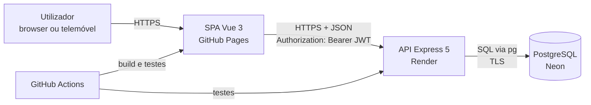
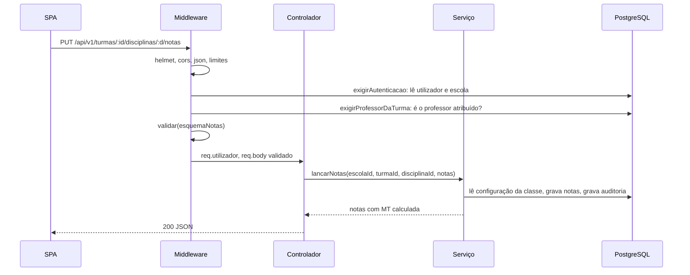

# Fase 2: Arquitectura e contrato da API

**Projeto:** Sistema de Gestão Escolar (Angola, várias escolas)
**Estado:** aprovado (actualizado para PostgreSQL)
**Data:** 2026-11-08
**Base:** [00-enquadramento.md](00-enquadramento.md) · [01-requisitos.md](01-requisitos.md) · Contrato completo: [openapi.yaml](openapi.yaml)

---

## 1. Visão geral



| Componente | Responsabilidade | Não faz |
|---|---|---|
| SPA (Vue 3) | Ecrãs, navegação por perfil, validação de conveniência nos formulários | Não decide permissões nem calcula notas oficiais |
| API (Express 5) | Autenticação, autorização, regras de negócio, cálculo de notas, auditoria | Não guarda ficheiros (o disco do Render é efémero) |
| PostgreSQL (Neon) | Persistência; integridade com chaves estrangeiras, `CHECK` e índices únicos; cálculo exacto das médias | — |

**Princípio:** o servidor é a única fonte da verdade. As médias que o front-end mostra vêm sempre da API.

---

## 2. Estrutura do back-end

```
api/
  src/
    app.js                 cria a aplicação Express (sem listen, para os testes)
    servidor.js            liga à BD e faz listen
    config/                ambiente.js (valida as variáveis com Zod), bd.js (pool pg, emTransaccao)
    bd/                    migracoes.js (aplica migrations/*.sql), seed.js
    util/sql.js            inserir, actualizar, paginar, camel (SQL sempre parametrizado)
    routes/index.js        todas as rotas, montadas em /api/v1 (autenticação → perfil → validação → controlador)
    controllers/index.js   lê o pedido validado (req.dados), chama o serviço, responde
    services/              regras de negócio e consultas SQL, um ficheiro por área
      avaliacao.js         decidirTransicao (as médias são calculadas na BD)
      matriculas.js        regras de matrícula e confirmação
      auditoria.js         registar(alteração)
    middleware/
      autenticacao.js      exigirAutenticacao (JWT → utilizador da BD)
      autorizacao.js       exigirPerfil(...perfis), exigirProfessorDaTurma
      validar.js           validar(esquemaZod, 'body' | 'query' | 'params')
      erros.js             tratarErros, ErroAplicacao
      limites.js           limitação de pedidos do login
    validacao/             esquemas Zod por recurso
  tests/
    unit/                  services/*
    bd/                    restrições e vista de resultados, com PGlite (PostgreSQL em memória)
    integracao/            Supertest + PGlite
  migrations/              001_inicial.sql, 002_..., aplicadas por ordem
  scripts/                 migrar.js, seed.js
```

### Fluxo de um pedido



---

## 3. Várias escolas (isolamento)

1. `exigirAutenticacao` verifica o JWT e **lê o utilizador da base de dados**. Daí saem o `perfil`, a `escola` e o estado da conta e da escola. O token só traz o `id`.
2. As rotas da escola não têm `:escolaId` na URL. A escola é sempre `req.utilizador.escola`.
3. Todos os serviços recebem `escolaId` como primeiro argumento e usam-no em **todas** as consultas:
   ```javascript
   const { rows } = await bd.query(
     'SELECT * FROM alunos WHERE id = $1 AND escola_id = $2', // sempre parâmetros, nunca concatenar texto
     [alunoId, escolaId],
   );
   if (!rows[0]) throw new ErroAplicacao('Aluno não encontrado.', 404);
   ```
   Como segunda barreira, as chaves estrangeiras compostas `(escola_id, id)` impedem, na própria base de dados, que uma matrícula, nota ou falta ligue registos de escolas diferentes.
4. Um recurso de outra escola responde **404** e não 403, para não revelar que existe.
5. O administrador da plataforma usa só as rotas `/plataforma/*` e não tem acesso às rotas da escola.
6. Testes de integração com duas escolas fictícias verificam o isolamento em cada recurso.

---

## 4. Autenticação e autorização

| Aspeto | Decisão |
|---|---|
| Token | JWT `HS256`, validade de 8 h (um dia de aulas), `issuer` e `audience` fixos |
| Conteúdo do token | Só `sub` (id do utilizador). O perfil e a escola são lidos da BD em cada pedido |
| Guardar no browser | `sessionStorage` (fecha com o separador) e store Pinia |
| Palavra-passe | bcrypt, custo 12, mínimo de 8 caracteres; troca obrigatória no primeiro acesso |
| Login | 5 tentativas por 15 min por IP; mensagem genérica "Email ou palavra-passe incorrectos." |

### Matriz de permissões (resumo)

| Recurso | AP | DE | SE | CO | DT | PR |
|---|---|---|---|---|---|---|
| Escolas | CRUD | — | — | — | — | — |
| Utilizadores da escola | — | CRUD | — | — | — | — |
| Ano lectivo, classes, avaliação | — | CRUD | L | L | L | L |
| Cursos, disciplinas, planos | — | CRUD | L | CRUD¹ | L | L |
| Alunos e encarregados | — | L | CRUD | L | L² | — |
| Turmas e atribuições | — | CRUD | CRU | CRU¹ | L² | L³ |
| Matrículas | — | L | CRUD | — | L² | — |
| Notas (lançar) | — | — | — | — | — | CU³ |
| Notas (publicar) | — | ✓ | — | — | ✓² | — |
| Notas (corrigir publicada) | — | ✓ | — | — | — | — |
| Pautas | — | L | L | L¹ | L² | L³ |
| Faltas | — | L | L | — | L + justificar² | CU³ |
| Estágio e TFC | — | L | CRU | CRUD¹ | — | — |
| Auditoria | — | L | — | — | — | — |

L = ler · C = criar · R = ler · U = actualizar · D = desactivar
¹ só nos seus cursos ou classes · ² só nas turmas que dirige · ³ só nas turmas e disciplinas atribuídas

---

## 5. Convenções da API

- Base: `/api/v1`. JSON em UTF-8. Datas em ISO 8601 na API (`2026-11-08`), mostradas como dd/mm/aaaa no front-end.
- Nomes de recursos no plural e em português: `/alunos`, `/turmas`, `/anos-lectivos`.
- Acções que não são CRUD usam um sub-recurso com verbo: `POST /matriculas/:id/anular`, `POST /turmas/:id/trimestres/:n/publicar`.
- "Apagar" é desactivar (`estado: "inactivo"`). Não existe `DELETE` em notas, matrículas, faltas nem alunos.
- Paginação: `?pagina=1&limite=20` → `{ "dados": [...], "pagina": 1, "limite": 20, "total": 134 }`.
- Formato de erro igual em toda a API:
  ```json
  { "mensagem": "Dados inválidos.", "codigo": "VALIDACAO", "detalhes": [{ "campo": "npt", "mensagem": "Máximo 20." }] }
  ```

| Código | Quando |
|---|---|
| 200 / 201 / 204 | Leitura / criação / sem corpo |
| 400 | JSON mal formado ou campos com tipo errado (Zod) |
| 401 | Sem token, token inválido ou expirado |
| 403 | Autenticado, mas sem permissão (perfil ou turma errada) |
| 404 | Não existe **ou** pertence a outra escola |
| 409 | Conflito: matrícula duplicada, turma cheia, código repetido |
| 422 | Regra de negócio: nota fora da escala, trimestre fechado, exame numa classe que não é de exame |
| 429 | Demasiadas tentativas de login |

---

## 6. Contrato da API (resumo)

O detalhe dos corpos e das respostas está em [openapi.yaml](openapi.yaml). Todas as rotas, excepto `/saude` e `/auth/login`, exigem um token.

### Sistema e autenticação
| Método | Caminho | Perfis | RF | Respostas |
|---|---|---|---|---|
| GET | `/saude` | público | RNF11 | 200 |
| POST | `/auth/login` | público | RF05 | 200, 400, 401, 429 |
| GET | `/auth/eu` | todos | RF05 | 200, 401 |
| POST | `/auth/palavra-passe` | todos | RF06 | 204, 400, 401, 422 |

### Plataforma
| Método | Caminho | Perfis | RF | Respostas |
|---|---|---|---|---|
| GET | `/plataforma/escolas` | AP | RF01, RF04 | 200 |
| POST | `/plataforma/escolas` | AP | RF01 | 201, 400, 409 |
| PATCH | `/plataforma/escolas/:id` | AP | RF03 | 200, 404 |
| POST | `/plataforma/escolas/:id/director` | AP | RF02 | 201, 404, 409 |

### Utilizadores da escola
| Método | Caminho | Perfis | RF | Respostas |
|---|---|---|---|---|
| GET | `/utilizadores` | DE | RF07 | 200 |
| POST | `/utilizadores` | DE | RF07 | 201, 400, 409 |
| PATCH | `/utilizadores/:id` | DE | RF09 | 200, 404 |
| POST | `/utilizadores/:id/repor-palavra-passe` | DE | RF08 | 200, 404 |

### Estrutura de ensino
| Método | Caminho | Perfis | RF | Respostas |
|---|---|---|---|---|
| GET | `/anos-lectivos` | todos | RF10 | 200 |
| POST | `/anos-lectivos` | DE | RF10 | 201, 400, 422 |
| PATCH | `/anos-lectivos/:id` | DE | RF10 | 200, 404, 422 |
| POST | `/anos-lectivos/:id/activar` | DE | RF10 | 200, 404, 409 |
| GET | `/catalogo/classes` | todos | RF11 | 200 |
| GET | `/classes` | todos | RF11 | 200 |
| POST | `/classes` | DE | RF11, RF14 | 201, 409, 422 |
| PATCH | `/classes/:id` | DE | RF14 | 200, 404, 422 |
| GET, POST | `/cursos` | todos / DE, CO | RF12 | 200 / 201, 409 |
| PATCH | `/cursos/:id` | DE, CO | RF12 | 200, 404 |
| GET, POST | `/disciplinas` | todos / DE, CO | RF13 | 200 / 201, 409 |
| PATCH | `/disciplinas/:id` | DE, CO | RF13 | 200, 404 |
| GET | `/planos-curriculares?classe=&curso=` | todos | RF13 | 200 |
| PUT | `/planos-curriculares/:id` | DE, CO | RF13 | 200, 404, 422 |
| POST | `/planos-curriculares` | DE, CO | RF13 | 201, 409 |

### Pessoas
| Método | Caminho | Perfis | RF | Respostas |
|---|---|---|---|---|
| GET | `/alunos?pesquisa=&turma=&pagina=` | DE, SE, CO, DT | RF17 | 200 |
| POST | `/alunos` | SE | RF15 | 201, 400, 409 |
| GET | `/alunos/:id` | DE, SE, CO, DT | RF15 | 200, 404 |
| PATCH | `/alunos/:id` | SE | RF15 | 200, 404, 409 |
| GET, POST | `/encarregados` | SE | RF16 | 200 / 201 |
| PUT | `/alunos/:id/encarregados` | SE | RF16 | 200, 404 |
| GET, POST | `/professores` | DE, SE | RF18 | 200 / 201, 409 |
| PATCH | `/professores/:id` | DE, SE | RF18 | 200, 404 |

### Turmas e matrículas
| Método | Caminho | Perfis | RF | Respostas |
|---|---|---|---|---|
| GET | `/turmas?anoLectivo=&classe=&turno=` | todos⁴ | RF19 | 200 |
| POST | `/turmas` | DE, SE | RF19 | 201, 409, 422 |
| GET | `/turmas/:id` | todos⁴ | RF19 | 200, 404 |
| PATCH | `/turmas/:id` | DE, SE | RF19 | 200, 404, 409 |
| GET | `/turmas/:id/atribuicoes` | todos⁴ | RF20 | 200 |
| PUT | `/turmas/:id/atribuicoes` | DE, CO | RF20 | 200, 404, 422 |
| GET | `/matriculas?anoLectivo=&turma=` | DE, SE, DT | RF21 | 200 |
| POST | `/matriculas` | SE | RF21 | 201, 409, 422 |
| POST | `/matriculas/confirmacoes` | SE | RF22 | 201, 409, 422 |
| POST | `/matriculas/:id/mudar-turma` | SE | RF23 | 200, 404, 409 |
| POST | `/matriculas/:id/anular` | SE | RF23 | 200, 404, 422 |

⁴ O professor só vê as suas turmas e o director de turma as que dirige.

### Avaliação
| Método | Caminho | Perfis | RF | Respostas |
|---|---|---|---|---|
| GET | `/turmas/:id/disciplinas/:disciplinaId/notas?trimestre=` | PR³, DT², DE | RF24, RF25 | 200, 403, 404 |
| PUT | `/turmas/:id/disciplinas/:disciplinaId/notas?trimestre=` | PR³ | RF24, RF25 | 200, 403, 422 |
| PUT | `/turmas/:id/disciplinas/:disciplinaId/exame` | PR³, SE | RF27, RF28 | 200, 403, 422 |
| PUT | `/turmas/:id/avaliacoes-descritivas?trimestre=` | PR³ | RF33 | 200, 403, 422 |
| POST | `/turmas/:id/trimestres/:n/publicar` | DT², DE | RF30 | 200, 403, 422 |
| POST | `/notas/:id/correccoes` | DE | RF31 | 200, 404, 422 |
| GET | `/turmas/:id/pautas/trimestres/:n` | DE, SE, DT², CO¹ | RF32 | 200, 404 |
| GET | `/turmas/:id/pautas/final` | DE, SE, DT², CO¹ | RF26, RF28, RF29, RF32 | 200, 404 |
| GET | `/turmas/:id/pautas/final?formato=csv` | DE, DT² | RF34 | 200 (text/csv) |

### Assiduidade
| Método | Caminho | Perfis | RF | Respostas |
|---|---|---|---|---|
| PUT | `/turmas/:id/disciplinas/:disciplinaId/faltas?data=` | PR³ | RF35 | 200, 403, 422 |
| GET | `/turmas/:id/faltas?aluno=&trimestre=` | DT², DE, PR³ | RF37 | 200 |
| POST | `/faltas/:id/justificar` | DT² | RF36 | 200, 404, 422 |
| GET | `/turmas/:id/faltas/resumo?trimestre=` | DT², DE | RF37 | 200 |

### Estágio e TFC (13.ª classe, desejável)
| Método | Caminho | Perfis | RF | Respostas |
|---|---|---|---|---|
| GET, POST | `/estagios` | SE, CO¹ | RF40 | 200 / 201, 422 |
| PATCH | `/estagios/:id` | SE, CO¹ | RF40, RF41 | 200, 404, 422 |
| PATCH | `/estagios/:id/tfc` | CO¹ | RF42, RF43 | 200, 404, 422 |

### Painel e auditoria
| Método | Caminho | Perfis | RF | Respostas |
|---|---|---|---|---|
| GET | `/painel?anoLectivo=` | DE | RF38 | 200 |
| GET | `/auditoria?utilizador=&entidade=&de=&ate=&pagina=` | DE | RF39 | 200 |

---

## 7. Cálculo das notas (núcleo do sistema)

O cálculo divide-se em duas partes:

1. **Na base de dados, em `numeric` (exacto):**
   - `notas.mt` é uma coluna gerada: `(mac + npp + npt) / 3`.
   - A vista `v_resultados_disciplina` calcula a MFD como `soma(MAC + NPP + NPT) / 9`, a CF como `(0,4 × soma + 5,4 × exame) / 9`, e a nota final com `round()`, que arredonda 9,5 para 10.
2. **No serviço `decidirTransicao` (JavaScript puro):** com as notas finais, que já são inteiros, decide se o aluno transita (RN13–RN17).

> Porquê na base de dados: em JavaScript, `(8.7 + 10.1 + 9.7) / 3` dá 9,4999… e `Math.round` devolve 9 em vez de 10. O tipo `numeric` do PostgreSQL não tem este erro. Há um teste automático que confirma os dois comportamentos.

```javascript
// src/services/avaliacao.js (resumo)
export function decidirTransicao(classe, resultados) {
  // resultados: [{ notaFinal, chave }]
  const negativas = resultados.filter((r) => r.notaFinal < classe.notaMinimaAprovacao);
  if (classe.classeDeExame) return negativas.length === 0 ? 'transita' : 'nao_transita';  // RN17
  return negativas.length <= classe.maxNegativas &&                // 2
         negativas.every((r) => r.notaFinal > classe.minimoNegativa) && // 7 ou 3,5
         negativas.every((r) => !r.chave)
    ? 'transita' : 'nao_transita';
}
```

---

## 8. Front-end (mapa de navegação)

| Rota | Ecrã | Perfis |
|---|---|---|
| `/entrar` | Login | visitante |
| `/` | Início (atalhos conforme o perfil) | todos |
| `/plataforma/escolas` | Escolas | AP |
| `/escola/configuracao` | Ano lectivo, classes, cursos, disciplinas, planos | DE, CO |
| `/utilizadores` | Utilizadores | DE |
| `/alunos`, `/alunos/:id` | Alunos e processo do aluno | SE, DE |
| `/turmas`, `/turmas/:id` | Turmas, alunos, atribuições | SE, DE, CO, DT |
| `/matriculas` | Matrículas e confirmações | SE |
| `/minhas-turmas` | Turmas e disciplinas do professor | PR |
| `/turmas/:id/notas/:disciplina` | Lançamento de notas (grelha) | PR |
| `/turmas/:id/faltas/:disciplina` | Registo de faltas | PR |
| `/turmas/:id/pautas` | Pautas trimestrais e final | DT, DE, SE |
| `/auditoria` | Registo de auditoria | DE |

Cada rota tem `meta: { perfis: [...] }`, e a guarda `beforeEach` redirecciona para `/` quem não tiver o perfil. A API volta a verificar sempre.

---

## 9. Publicação e configuração

| Variável | Onde | Exemplo |
|---|---|---|
| `NODE_ENV` | Render | `production` |
| `DATABASE_URL` | Render | (segredo, cadeia de ligação do Neon, com `sslmode=require`) |
| `JWT_SECRET` | Render | (segredo, ≥ 32 caracteres) |
| `JWT_EXPIRA` | Render | `8h` |
| `CORS_ORIGENS` | Render | `https://<utilizador>.github.io` (só a origem) |
| `VITE_API_URL` | GitHub Actions (vars) | `https://<servico>.onrender.com/api/v1` |

---

## 10. Decisões de compromisso

| Decisão | Alternativa rejeitada | Motivo |
|---|---|---|
| PostgreSQL | MongoDB | Domínio muito relacional: chaves estrangeiras, restrições, `JOIN` nas pautas e cálculo exacto em `numeric` (ver 03-dados.md) |
| Uma base de dados com `escola_id` em cada tabela | Uma base de dados por escola | Mais simples no plano gratuito; o isolamento é garantido pelas chaves compostas e testado |
| SQL escrito à mão com `pg` | ORM (Prisma, Drizzle) | O esquema usa índices parciais, `CHECK`, colunas geradas e uma vista, que se escrevem melhor em SQL; mostra o desenho da BD na defesa |
| JWT em `sessionStorage` | Cookie `httpOnly` | A SPA e a API estão em domínios diferentes (GitHub Pages e Render); os cookies entre domínios complicam o CORS. O risco de XSS mitiga-se com o Vue, que escapa o HTML, e com uma CSP |
| Notas calculadas e guardadas na API | Cálculo no front-end | Uma só fonte da verdade, e as pautas carregam mais depressa |
| Lançamento de notas em lote (`PUT` da turma inteira) | Um pedido por aluno | Menos pedidos com ligações fracas (RNF06) |
| Render gratuito | Plano pago | Projecto académico; o atraso no primeiro pedido fica documentado |
| Sem `DELETE` em dados académicos | Eliminação física | Integridade e auditoria (RNF04) |
