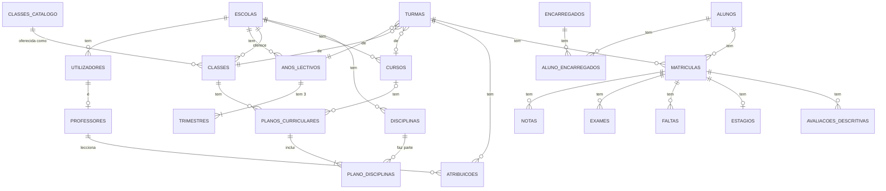

# Fase 3: Dados (PostgreSQL)

**Projeto:** Sistema de Gestão Escolar (Angola, várias escolas)
**Estado:** proposta para aprovação
**Data:** 2026-11-08
**Código:** [api/migrations/001_inicial.sql](../api/migrations/001_inicial.sql) · [api/src/bd/seed.js](../api/src/bd/seed.js) · testes em [api/tests/](../api/tests/)

---

## 1. Porquê PostgreSQL (justificação para a defesa)

O professor pediu a base de dados mais adequada ao projecto. Os dados de uma escola são fortemente relacionais: escolas → turmas → matrículas → notas e faltas, sempre cruzadas com alunos, disciplinas e professores. Uma base de dados relacional garante as regras mais importantes **na própria base de dados**, e não apenas no código.

| Necessidade do projecto | Como o PostgreSQL a resolve | Alternativa considerada |
|---|---|---|
| Uma matrícula ou nota nunca aponta para um registo inexistente | Chaves estrangeiras | MongoDB: só no código da aplicação |
| Dados da Escola A nunca se misturam com os da Escola B (RNF01) | Chaves estrangeiras compostas `(escola_id, id)` | MongoDB: só no código |
| Uma só matrícula **activa** por aluno e ano lectivo (RN06) | Índice único parcial (`WHERE estado = 'activa'`) | MariaDB/MySQL: não tem índices parciais |
| Notas sempre entre 0 e 20 (RN05) | `CHECK` | — |
| Médias sem erros de arredondamento (9,5 → 10) | Tipo `numeric` exacto e coluna gerada para a MT | JavaScript: `(8.7 + 10.1 + 9.7) / 3` dá 9,4999… |
| Pautas: alunos × disciplinas × notas | `JOIN` e vistas | MongoDB: `$lookup`, mais verboso |
| Notas e auditoria nunca apagadas (RNF04) | Triggers que recusam `DELETE`/`UPDATE` | — |
| Operações com vários passos (matricular e registar histórico) | Transacções ACID | — |

**Porque não MariaDB:** também é relacional, mas não tem índices parciais nem `UNIQUE NULLS NOT DISTINCT`, que este esquema usa em três regras.

---

## 2. Modelo de dados



### Tabelas por módulo

| Módulo | Tabelas |
|---|---|
| M1 Plataforma | `escolas` |
| M2 Utilizadores | `utilizadores` |
| M3 Estrutura | `anos_lectivos`, `trimestres`, `classes_catalogo` (Iniciação a 13.ª), `classes`, `cursos`, `disciplinas`, `planos_curriculares`, `plano_disciplinas` |
| M4 Pessoas | `alunos`, `encarregados`, `aluno_encarregados`, `professores`, `professor_disciplinas` |
| M5 Turmas | `turmas`, `atribuicoes`, `publicacoes`, `matriculas`, `matricula_historico` |
| M6 Avaliação | `notas` (uma linha por aluno, disciplina e trimestre), `exames`, `avaliacoes_descritivas`, vista `v_resultados_disciplina` |
| M7 Assiduidade | `faltas` (de presença e vermelhas, com a ocorrência) |
| M8 Auditoria | `auditoria` |
| M9 Estágio | `estagios` (inclui o TFC) |
| Documentos | `documentos` (certificados e declarações numerados, com os dados congelados), `historico_escolar` |
| Horários | `tempos` (por turno), `aulas` (índices únicos impedem conflitos de professor e de sala) |
| M10 Pagamentos | `rubricas` (preçário), `cobrancas`, `pagamentos` (recibos numerados por escola e ano), `pagamento_itens` |
| M11 Portal | `avisos`, `avisos_lidos`; contas ligadas por `encarregados.utilizador_id` e `alunos.utilizador_id` |

### Migrações

| Ficheiro | Conteúdo |
|---|---|
| `001_inicial.sql` | Esquema base (M1–M9), vista `v_resultados_disciplina`, triggers |
| `002_faltas_anuladas.sql` | Faltas desmarcadas passam a "anulada" |
| `003_documentos.sql` | Documentos emitidos, dados do aluno para os certificados, decreto da escola |
| `004_historico_escolar.sql` | Notas de anos anteriores |
| `005_portal.sql` | Perfis encarregado e aluno |
| `006_horarios.sql` | Tempos lectivos e aulas |
| `007_declaracoes.sql` | Declarações de frequência e com notas |
| `008_pagamentos.sql` | Preçário, cobranças, pagamentos e recibos |
| `009_avisos.sql` | Faltas vermelhas, avisos do portal, limite de faltas da escola |

São aplicadas por ordem por `npm run migrar` (no Render, a cada publicação). Uma migração aplicada não se altera: as mudanças vão numa migração nova.

### Decisões de desenho
- **UUID** como chave primária: não revela quantos alunos há nem permite adivinhar ids.
- **`CHECK` em vez de `ENUM`:** acrescentar um valor (por exemplo, um novo turno) é só alterar uma restrição.
- **Configuração de avaliação na tabela `classes`:** escala, nota mínima, classe de exame, Iniciação qualitativa, 13.ª só de estágio, máximo de negativas e mínimo da negativa. Nada disto fica escrito no código.
- **Disciplinas-chave em `plano_disciplinas.chave`:** dependem da classe e do curso.
- **Uma linha por trimestre em `notas`:** permite publicar e corrigir cada trimestre em separado e registar quem lançou cada nota.
- **Publicação por turma e trimestre em `publicacoes`:** é a turma inteira que fica publicada, não cada nota.

---

## 3. Regras garantidas pela base de dados

| Regra | Mecanismo | Nome no esquema |
|---|---|---|
| RNF01 Isolamento entre escolas | Chaves estrangeiras compostas `(escola_id, …)` em todas as ligações | — |
| Matrícula no mesmo ano lectivo da turma | Chave estrangeira `(escola_id, turma_id, ano_lectivo_id)` | — |
| RN05 Notas entre 0 e 20 | `CHECK` | `notas_mac_check`, `notas_npp_check`, `notas_npt_check` |
| RN06 Uma matrícula activa por ano | Índice único parcial | `matriculas_uma_activa` |
| RN11 13.ª só no técnico-profissional e só de estágio | `CHECK` | `classe_13_tecnica` |
| RF10 Um ano lectivo activo por escola | Índice único parcial | `anos_lectivos_um_activo` |
| RF20 Um professor por disciplina e turma | Chave primária `(turma_id, disciplina_id)` | — |
| RF35 Sem faltas repetidas | `UNIQUE (matricula_id, disciplina_id, data)` | — |
| RF36 Falta justificada tem motivo e autor | `CHECK` | `faltas_check` |
| RF23 Mudar de turma e anular exigem motivo | `CHECK` | `matricula_historico_check` |
| RF53 Professor ou sala ocupados duas vezes no mesmo tempo | Índices únicos | `aulas_professor_sem_conflito`, `aulas_sala_sem_conflito` |
| RF58 A mesma propina não se gera duas vezes | Índice único parcial | `cobrancas_propina_unica` |
| RF60 Número do recibo único por escola e ano | `UNIQUE` | `pagamentos_escola_id_ano_numero_key` |
| RF61 Cobranças e pagamentos não se apagam; anulação com motivo | Triggers e `CHECK` | `cobrancas_sem_delete`, `pagamentos_sem_delete` |
| RF64 Falta vermelha com ocorrência e nunca justificada | `CHECK` | `faltas_disciplinar_com_ocorrencia`, `faltas_disciplinar_nao_justificada` |
| RF25 MT calculada | Coluna gerada `mt` | — |
| RF43 Curso concluído com estágio e TFC ≥ 10 | Coluna gerada `curso_concluido` | — |
| RNF04 Notas, exames, matrículas e faltas não se apagam | Trigger `BEFORE DELETE` | `*_sem_delete` |
| RNF04 Auditoria só aceita inserções | Trigger `BEFORE UPDATE OR DELETE` | `auditoria_so_insercao` |
| Email único sem distinguir maiúsculas | Índice único em `lower(email)` | `utilizadores_email_unico` |

**Ficam no serviço**, porque dependem do contexto do pedido ou de várias linhas:
- A capacidade da turma (RN07): `SELECT … FOR UPDATE` na turma, dentro da transacção da matrícula.
- A escala de cada classe (0–10 ou 0–20) no lançamento de notas.
- O trimestre aberto e a publicação.
- O professor atribuído (RN08).
- Os trimestres sem sobreposição.

> **Armadilha encontrada pelos testes:** num `CHECK`, um resultado `NULL` conta como verdadeiro. A primeira versão de `CHECK (length(motivo) >= 3)` aceitava um motivo vazio (`NULL`). A versão final usa `coalesce(length(motivo), 0) >= 3`.

---

## 4. Cálculo das notas (vista `v_resultados_disciplina`)

| Valor | Fórmula em SQL | Arredonda? |
|---|---|---|
| MT | coluna gerada `(mac + npp + npt) / 3` | Não |
| MFD | `soma(mac + npp + npt) / 9`, só com os 3 trimestres completos | Não |
| CF (classes de exame) | `(0,4 × soma + 5,4 × exame) / 9` | Não |
| Nota final | `round(MFD)` nas classes normais; `round(CF)` nas classes de exame | Sim, à unidade (9,5 → 10) |

A MFD e a CF são calculadas a partir da **soma** das notas, com uma só divisão no fim, para não acumular arredondamentos intermédios. A decisão de transição (RN13–RN17) é feita em `src/services/avaliacao.js` com as notas finais da vista.

---

## 5. Dados de teste (seed)

São dados **fictícios**, com a mesma palavra-passe para todos os utilizadores (`Teste#2026` por omissão). O seed recusa correr em produção e numa base de dados que já tenha escolas.

| Escola | Classes e turmas | Utilizadores |
|---|---|---|
| Complexo Escolar Fictício n.º 101 (Luanda, Viana) | Iniciação A, 6.ª A (exame, 0–10), 7.ª A (0–20), 9.ª A (exame) | director@lda101.test, secretaria@lda101.test, lurdes@…, adao@… |
| Instituto Médio Técnico Fictício do Huambo | 10.ª A, 12.ª A (exame) e 13.ª A (estágio), curso Técnico de Informática | director@hbo201.test, secretaria@…, coordenador@…, rui@…, marta@… |
| — | — | admin@plataforma.test (administrador da plataforma) |

Cada aluno representa um caso de teste:

| Turma | Caso | Resultado esperado |
|---|---|---|
| 7.ª e 10.ª | Todas positivas | Transita |
| 7.ª e 10.ª | Duas negativas (9 e 8) fora das disciplinas-chave | Transita |
| 7.ª e 10.ª | Uma negativa de 7 | Não transita |
| 7.ª e 10.ª | Negativa de 9 numa disciplina-chave (MAT ou PROG) | Não transita |
| 7.ª e 10.ª | MFD 9,5 | Nota final 10, transita |
| 6.ª, 9.ª e 12.ª | MFD 12, exame 9 → CF 10,2 | 10, transita |
| 6.ª, 9.ª e 12.ª | Uma só CF negativa (9) | Não transita (classe de exame) |
| 6.ª, 9.ª e 12.ª | MFD 8, exame 12 → CF 10,4 | 10, transita |
| 6.ª, 9.ª e 12.ª | Sem nota de exame | Pendente |
| Iniciação | Avaliação descritiva | Sem notas numéricas |
| 13.ª | Estágio 15 e TFC 14 | Curso concluído |
| 13.ª | Estágio a decorrer | Curso por concluir |

Na escala 0–10 (6.ª classe), os valores são metade dos da tabela.

---

## 6. Testes

Os testes usam o **PGlite**, um PostgreSQL 16 completo que corre dentro do Node. Não é preciso instalar nada, e os testes também correm no GitHub Actions.

```
✓ tests/unit/avaliacao.test.js    (8 testes)   regras de transição
✓ tests/bd/restricoes.test.js     (18 testes)  isolamento, matrículas, notas, estrutura, utilizadores, faltas, estágio, auditoria
✓ tests/bd/resultados.test.js     (5 testes)   vista de resultados e situação de cada aluno do seed
Tests  31 passed (31)
```

---

## 7. Como usar

```bash
cd api
npm install
cp .env.example .env          # preencher DATABASE_URL

# PostgreSQL local com Docker (opcional)
docker run -d --name pg-escola -e POSTGRES_PASSWORD=postgres -e POSTGRES_DB=gestao_escolar -p 5432:5432 postgres:16

npm run migrar                # cria as tabelas
npm run seed                  # dados fictícios (só em desenvolvimento)
npm test                      # 31 testes, sem precisar de servidor
```

**Em produção (Neon):**
1. Criar o projecto e a base de dados `gestao_escolar`.
2. Copiar a cadeia de ligação, que inclui `sslmode=require`, para `DATABASE_URL` no Render.
3. Correr `npm run migrar` uma vez.
4. Fazer cópias de segurança com `pg_dump` (semanalmente, RNF11) e testar a reposição.

---

## 8. Pendentes e melhorias opcionais
- [ ] Confirmar as condições actuais do plano gratuito do Neon (ou usar Supabase).
- [ ] Opcional: *Row-Level Security* do PostgreSQL como terceira barreira de isolamento entre escolas.
- [ ] Opcional: um utilizador da base de dados para a aplicação sem permissão de `DELETE`, e outro para as migrações.
