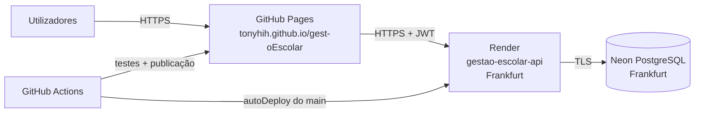

# Fase 6: Publicação e operação

**Projeto:** Sistema de Gestão Escolar (Angola, várias escolas)
**Estado:** pronto a publicar (faltam 5 passos no browser, nas contas do autor)
**Data:** 2026-11-08



> ⚠️ As condições dos planos gratuitos (Neon, Render e GitHub Pages) mudam com frequência. Confirme-as nos sites antes da defesa. Os valores aqui são os conhecidos à data deste documento.

---

## 1. O que foi preparado no repositório

| Ficheiro | Para quê |
|---|---|
| `render.yaml` | Blueprint do Render: serviço `gestao-escolar-api`, Node 24, região Frankfurt, verificação em `/api/v1/saude`, `JWT_SECRET` gerado pelo Render |
| `api/package.json` → `migrar:producao`, `start` | No arranque, o Render aplica as migrações novas (idempotente) e inicia a API |
| `api/scripts/primeiro-admin.js` | No arranque do Render, cria o primeiro administrador se ainda não existir (palavra-passe provisória nos Logs) |
| `api/scripts/criar-admin.js` | Alternativa: cria o administrador a partir do seu computador |
| `api/scripts/copia-seguranca.sh` | Cópia de segurança semanal com `pg_dump`, verificação e remoção das cópias com mais de 90 dias |
| `.github/workflows/web.yml` | Testa e publica o front-end no GitHub Pages a partir do `main` |
| `.github/dependabot.yml` | Revisão mensal das dependências (npm e GitHub Actions) |
| `web/src/views/PrivacidadeView.vue` | Política de privacidade (Lei n.º 22/11), visível sem sessão |

### Verificações feitas antes de publicar
- **Dependências:** `npm audit` encontrou vulnerabilidades críticas no `tar` (através do `bcrypt` 5) e altas no `zod` 3. Foram actualizados para o `bcrypt` 6 e o `zod` 4. Agora há **0 vulnerabilidades** em produção, na API e no front-end, e os 87 testes da API passam.
- **Driver `pg` real:** as migrações, o seed e o `servidor.js` correram com o driver `pg` através do protocolo PostgreSQL (servidor `pglite-socket`):
  - as duas migrações aplicaram-se, e uma segunda execução não refez nada;
  - a pauta deu as situações esperadas;
  - as datas chegaram sem desvio de fuso horário;
  - o CORS autorizou `https://tonyhih.github.io`.
- **Ainda não foi testado:** a ligação TLS ao Neon. Testa-se no passo 1.

---

## 2. Passo a passo (só no browser, por esta ordem)

Não precisa de instalar nada no seu computador. As migrações e o primeiro administrador são feitos pelo Render no arranque.

### Passo 1: Fazer o merge do pull request #1 (GitHub)
Abra https://github.com/Tonyhih/gest-oEscolar/pull/1, confirme que os testes estão verdes e carregue em **Merge pull request**. O Render e o GitHub Pages publicam a partir do `main`.

### Passo 2: Base de dados no Neon
1. Crie uma conta em **neon.tech** (pode entrar com a conta do GitHub).
2. Crie um projecto `gestao-escolar`:
   - **PostgreSQL 16 ou superior**;
   - região **AWS Europe Central (Frankfurt)**, a mesma do Render.
3. Em **Connect**, desligue a opção **Connection pooling** e copie a cadeia de ligação. Começa por `postgresql://` e termina em `?sslmode=require`. Guarde-a para o passo 3.

### Passo 3: API no Render
1. Crie uma conta em **render.com** com a conta do GitHub e dê-lhe acesso ao repositório `gest-oEscolar`.
2. Faça **New → Blueprint** e escolha o repositório. O Render lê o `render.yaml`.
3. Preencha os três valores que pede:
   - `DATABASE_URL`: a cadeia do Neon do passo 2.
   - `ADMIN_EMAIL`: o email com que vai entrar como administrador da plataforma.
   - `ADMIN_NOME`: o seu nome.
   O `CORS_ORIGENS` (`https://tonyhih.github.io`) e o `JWT_SECRET` já estão tratados.
4. Carregue em **Apply** e espere pelo deploy (alguns minutos).
5. Abra **Logs** e procure **"Administrador da plataforma criado"**. **Anote a palavra-passe provisória** que aparece nessa linha, porque só aparece uma vez.
6. Abra `https://gestao-escolar-api.onrender.com/api/v1/saude`. A resposta tem de ser `{"estado":"ok"}`.
   Se o Render tiver dado outro nome ao serviço (por exemplo, com um sufixo), crie no GitHub a variável `VITE_API_URL` com o endereço certo: **Settings → Secrets and variables → Actions → Variables**. Por exemplo, `https://gestao-escolar-api-xyz.onrender.com/api/v1`.

### Passo 3b: Email do segundo factor (Brevo)
O director recebe um código por email ao entrar. Sem esta configuração, o código aparece nos **Logs** do Render (modo de teste).
1. Crie uma conta gratuita em **brevo.com** (300 emails por dia).
2. Em **Senders, Domains & Dedicated IPs → Senders**, acrescente e confirme o email remetente (por exemplo, o email da escola).
3. Em **SMTP & API → API Keys**, crie uma chave. Copie-a: só aparece uma vez. **Não a envie por chat nem a ponha no repositório.**
4. No Render, abra o serviço → **Environment** e acrescente:
   - `BREVO_API_KEY`: a chave do passo 3;
   - `EMAIL_REMETENTE`: o email confirmado no passo 2.
5. Guarde. O Render reinicia a API. Entre como director: o código chega ao email do director.

Para desligar o segundo factor (por exemplo, numa demonstração), acrescente `SEGUNDO_FACTOR=desligado`.

### Passo 4: Front-end no GitHub Pages
1. No GitHub, abra **Settings → Pages → Build and deployment → Source** e escolha **GitHub Actions**.
2. Abra **Actions → Front-end (testes e GitHub Pages) → Run workflow** e escolha o ramo `main`.
3. Quando terminar, abra **https://tonyhih.github.io/gest-oEscolar/**.

### Passo 5: Primeiro uso
1. Entre com o `ADMIN_EMAIL` e a palavra-passe provisória dos Logs, e troque-a.
2. Em **Escolas**, registe a escola e crie a conta do director. Entregue-lhe a palavra-passe provisória.
3. O director entra, troca a palavra-passe e configura a escola, por esta ordem:
   1. ano lectivo e trimestres;
   2. classes;
   3. cursos e disciplinas;
   4. planos curriculares;
   5. utilizadores;
   6. turmas e atribuições.
4. Opcional: no Render, apague `ADMIN_EMAIL` e `ADMIN_NOME`. Já não são precisos, porque o administrador só é criado se ainda não existir.

**Alternativa sem o Render:** com o Node instalado, `npm run criar-admin` faz o mesmo a partir do seu computador. Veja o comentário em `api/scripts/criar-admin.js`.

---

## 3. Verificação depois de publicar

| # | Verificação | Como | Esperado |
|---|---|---|---|
| 1 | API viva | Abrir `/api/v1/saude` | `{"estado":"ok"}` |
| 2 | HTTPS | Abrir os dois endereços com `http://` | Redirecciona para `https://` |
| 3 | Login errado | Entrar com uma palavra-passe errada | "Email ou palavra-passe incorrectos." |
| 4 | Limite de tentativas | 6 tentativas erradas seguidas | À 6.ª: "Demasiadas tentativas" (429) |
| 5 | CORS | Na consola de outro site: `fetch('https://…onrender.com/api/v1/saude')` | Bloqueado pelo browser |
| 6 | Troca obrigatória | Primeiro acesso com uma palavra-passe provisória | Vai directo para "Alterar palavra-passe" |
| 7 | Recarregar a página | F5 em `…/gest-oEscolar/#/turmas` | Abre a mesma página (sem 404) |
| 8 | Telemóvel | Abrir no telemóvel e lançar notas | A grelha cabe no ecrã |
| 9 | Arranque a frio | Abrir depois de 15 min sem uso | Primeiro pedido lento (até ~1 min), depois normal |
| 10 | Segredos | Procurar `DATABASE_URL` e `JWT_SECRET` no GitHub | Não aparecem em nenhum ficheiro |

---

## 4. Operação

### Cópias de segurança (RNF11)
- **Todas as semanas**, no seu computador:
  ```bash
  DATABASE_URL='…' ./api/scripts/copia-seguranca.sh
  ```
  As cópias ficam em `~/copias-gestao-escolar`, com permissões só para o seu utilizador. Têm dados de menores: guarde-as num disco cifrado, **nunca no GitHub**.
- **Todos os meses**, faça um teste de reposição: crie uma base de dados de testes no Neon (um *branch*) e corra o comando indicado no fim do script. Confirme que a pauta de uma turma é igual à de produção.
- O Neon também guarda um histórico curto para recuperação a um momento anterior. Confirme o período no plano gratuito ⚠️.

### Registos e erros
- **Render → Logs:** os erros 500 aparecem com o detalhe completo. O utilizador só vê "Erro interno.".
- **Auditoria** (ecrã do director): quem alterou notas, matrículas e faltas, e quando.

### Actualizações
- **Dependabot:** abre pull requests mensais. Junte-os só se os testes do GitHub Actions passarem.
- **Alterações à base de dados:** sempre como uma nova migração (`migrations/003_….sql`), nunca editando uma migração já aplicada. O Render aplica-a no arranque seguinte.

### Incidentes
| Situação | O que fazer |
|---|---|
| O `JWT_SECRET` foi exposto | Render → Environment → gerar um novo valor → redeploy. Todas as sessões terminam |
| A palavra-passe da base de dados foi exposta | Neon → Roles → repor a palavra-passe → actualizar `DATABASE_URL` no Render |
| Uma conta foi usada indevidamente | O director desactiva o utilizador, consulta a auditoria e corrige as notas com justificação |
| A API não responde | Verificar `/saude` e os logs do Render; o plano gratuito pode estar suspenso por excesso de horas |

### Pedidos sobre dados pessoais (Lei n.º 22/11)
| Pedido | Procedimento |
|---|---|
| **Acesso** | A secretaria abre a ficha do aluno, imprime-a com a pauta e entrega-a ao encarregado ou ao aluno maior de idade |
| **Rectificação** | A secretaria corrige os dados pessoais na ficha. As notas são corrigidas pelo director, com justificação |
| **Eliminação** | O aluno passa a "inactivo". Matrículas, notas e pautas **não se apagam**, porque fazem parte do arquivo escolar. Os dados pessoais não essenciais (morada, telefone, documento) podem ser apagados na ficha |

⚠️ O prazo de conservação do arquivo escolar e o procedimento junto da APD (Agência de Protecção de Dados) têm de ser validados por um jurista ou pela escola. O texto da política de privacidade é uma proposta.

---

## 5. Limitações conhecidas (decisões documentadas)

| Limitação | Impacto | Mitigação |
|---|---|---|
| O Render gratuito suspende a API após 15 min sem pedidos ⚠️ | O primeiro pedido demora até ~1 min | Aceitável num projecto académico; num uso real, passar ao plano pago |
| O Render gratuito tem um limite mensal de horas ⚠️ | Um só serviço cabe no limite | Não criar mais serviços na mesma conta |
| Não há envio de email | As palavras-passe provisórias são entregues em mão | Fora do âmbito do MVP |
| O GitHub Pages não permite definir cabeçalhos HTTP | Sem CSP no front-end | A API tem o helmet; o Vue escapa o HTML; o token fica em `sessionStorage` |

---

## 6. Checklist global do projecto

- [x] **Fase 0:** âmbito do MVP definido (Angola, várias escolas, 60 dias, sem pagamentos)
- [x] **Fase 1:** 43 requisitos funcionais, 11 não funcionais, 18 regras de negócio com exemplos
- [x] **Fase 2:** arquitectura e contrato OpenAPI 3.1 validado
- [x] **Fase 3:** PostgreSQL com isolamento entre escolas, restrições e cálculo exacto das notas
- [x] **Fase 4:** API com 68 rotas e 96 testes (unitários, base de dados, integração), incluindo estágio, TFC e painel
- [x] **Fase 5:** front-end com 18 ecrãs, 13 testes unitários e 18 fluxos testados no browser
- [x] **Fase 6:** ficheiros de publicação, dependências sem vulnerabilidades, política de privacidade, cópias de segurança, guia de operação
- [ ] **Publicação real:** passos 1 a 5 acima (nas contas do autor)
- [ ] **Validações externas:** regras de avaliação com o professor; prazos de conservação e política de privacidade com um jurista

---

## 7. Registo de decisões (Fases 4 a 6)

| Data | Decisão | Motivo |
|---|---|---|
| 2026-11-08 | Faltas desmarcadas passam a "anulada" (migração 002) | Os dados académicos nunca se apagam (RNF04) |
| 2026-11-08 | SQL nos serviços, sem camada de repositórios | As consultas são específicas; menos código repetido |
| 2026-11-08 | `npm run dev:memoria` com PGlite | Demonstrações e desenvolvimento sem instalar o PostgreSQL |
| 2026-11-08 | `bcrypt` 6 e `zod` 4 | Vulnerabilidades críticas e altas nas versões anteriores |
| 2026-11-08 | Neon e Render na região de Frankfurt | Mais perto de Angola entre as regiões gratuitas, e ambos na mesma região |
| 2026-11-08 | Migrações aplicadas no arranque do Render | O plano gratuito não tem comando de pré-deploy; as migrações são idempotentes |
| 2026-11-08 | Primeiro administrador criado no arranque do Render (ADMIN_EMAIL) | Publicação só com o browser; em produção não há seed; a palavra-passe provisória obriga a troca |
| 2026-11-08 | Cópias de segurança locais, fora do GitHub | Contêm dados de menores |
